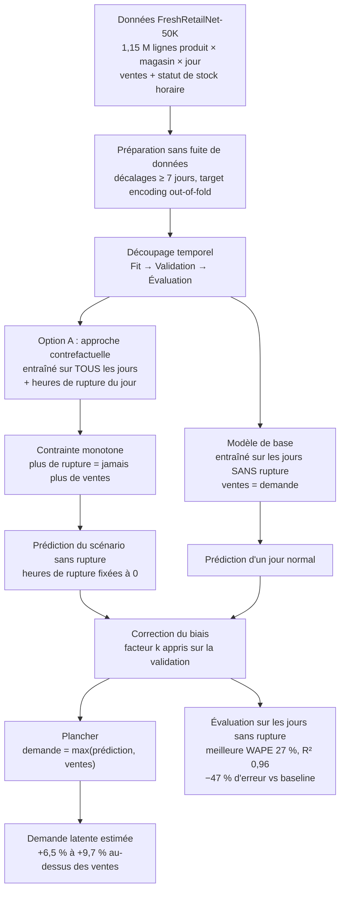

# Prédiction de la demande latente en retail alimentaire

Estimation de la **demande réelle** des produits frais lorsque les **ruptures de stock** empêchent de l'observer, à partir du jeu de données **FreshRetailNet-50K**.

> Notebook principal : `latent_demand_forecasting.ipynb`

---

## Vue d'ensemble



**Lecture du schéma :**
- Les deux branches (modèle de base et Option A) partagent les mêmes données, variables et découpage.
- La **précision** est mesurée sur les jours sans rupture, où la vraie demande est connue.
- La **demande latente** est estimée sur les jours en rupture, où elle est cachée.

---

## Sommaire

1. [Contexte et objectif](#1-contexte-et-objectif)
2. [Données](#2-données)
3. [Méthodologie](#3-méthodologie)
4. [Résultats](#4-résultats)
5. [Installation](#5-installation)
6. [Exécution](#6-exécution)
7. [Structure du notebook](#7-structure-du-notebook)
8. [Limites et pistes d'amélioration](#8-limites-et-pistes-damélioration)

---

## 1. Contexte et objectif

En retail alimentaire, les **ventes observées ne sont pas toujours égales à la demande** :

| Situation | Relation | Ce qu'on observe |
|---|---|---|
| Jour **sans** rupture | ventes = demande | La vraie demande |
| Jour **avec** rupture | ventes < demande | Une demande **censurée** (les clients venus pendant la rupture n'ont rien pu acheter) |

Dans ce jeu de données, **60 % des jours** présentent au moins une heure de rupture. Utiliser les ventes brutes revient donc à **sous-estimer la demande**, ce qui fausse les prévisions et entretient les ruptures.

**Objectif :** prédire la demande « sans rupture » de chaque produit, dans chaque magasin et chaque jour, puis **quantifier la demande perdue** à cause des ruptures.

---

## 2. Données

- **Source :** [Dingdong-Inc/FreshRetailNet-50K](https://huggingface.co/datasets/Dingdong-Inc/FreshRetailNet-50K) (Hugging Face), téléchargé automatiquement par le notebook.
- **Granularité :** une ligne = un produit × un magasin × un jour, avec le **statut de stock heure par heure**.
- **Filtrage :** suppression de 4 villes (`city_id` 0, 3, 12, 16).

| Élément | Valeur |
|---|---|
| Observations (train + éval) | 1 153 912 |
| Séries magasin × produit | 11 896 |
| Période | 97 jours (jusqu'au 2 juillet 2024) |
| Variables | ventes, remise, promotion, jour férié, météo, hiérarchie produit, statut de stock horaire |

---

## 3. Méthodologie

### 3.1 Protocole commun (sans fuite de données)

- **Variables explicatives :**
  - identifiants (ville, magasin, catégories, produit) ;
  - calendrier (jour de la semaine, week-end, jour du mois) ;
  - contexte (remise, promotion, jour férié, météo) ;
  - historique : ventes décalées de 7, 14, 21 et 28 jours, moyennes et écarts-types glissants, taux de rupture récent, moyenne du même jour de la semaine.
- **Pas de fuite de données :**
  - tous les décalages sont d'**au moins 7 jours** (horizon de prévision) ;
  - le target encoding est calculé **out-of-fold** ;
  - les imputations sont apprises sur le train uniquement.
- **Découpage temporel :**

  | Jeu | Période | Usage |
  |---|---|---|
  | Fit | 04/04 → 18/06/2024 | Entraînement |
  | Validation | 19/06 → 25/06/2024 | Choix des hyperparamètres, early stopping, facteur k |
  | Évaluation | 26/06 → 02/07/2024 | Mesure finale (jamais utilisée pour régler les modèles) |

- **Cible :** `log1p(ventes)` ; les métriques sont calculées sur l'échelle d'origine.
- **Correction du biais :** les modèles sous-prédisent d'environ 10 % (effet du passage par le log). Un facteur **k**, appris sur la validation, ramène le biais à environ −2 %.
- **Évaluation :** uniquement sur les **jours sans rupture**, seuls jours où la vraie demande est connue.

### 3.2 Modèle de base

```
Entraînement : uniquement les jours SANS rupture (≈ 390 000 lignes), cible = ventes = demande
Prédiction   : « Un jour normal comme celui-ci, combien vendrait-on ? »
```

- Avantage : cible propre, aucune vente « coupée » par une rupture.
- Inconvénient : on jette 60 % des données, et en particulier les jours de **forte demande** (c'est souvent parce qu'un produit se vend bien qu'il tombe en rupture).

### 3.3 Option A : approche contrefactuelle

```
Entraînement : TOUS les jours (≈ 990 000 lignes)
               + so_hours_today (heures de rupture du jour) et so_flag_today (rupture oui / non)
Prédiction   : on fixe so_hours_today = 0 et so_flag_today = 0
               -> « Combien aurait-on vendu s'il n'y avait pas eu de rupture ? »
```

- Avantage : 2,5 fois plus de données, y compris les jours de forte demande.
- Avantage : le modèle apprend **l'effet de la rupture** sur les ventes.
- Limite : risque de **confusion** entre rupture et forte demande, corrigé en 3.4.

### 3.4 Améliorations

1. **Contrainte monotone (LightGBM)** : plus d'heures de rupture ne peut **jamais augmenter** les ventes prédites (`monotone_constraints = -1` sur les variables de rupture).
2. **Plancher** : un jour en rupture, la demande est au moins égale aux ventes observées :
   `demande latente = max(prédiction, ventes observées)`.

### 3.5 Modèles comparés

LightGBM, XGBoost, CatBoost, Random Forest, MLP (scikit-learn), deux ensembles (moyenne simple, et moyenne pondérée avec poids optimisés sur la validation), et une **baseline naïve** (moyenne historique du même jour de la semaine).

---

## 4. Résultats

### 4.1 Précision : semaine d'évaluation, jours sans rupture

| Modèle | MAE | RMSE | R² | WAPE | Biais |
|---|---|---|---|---|---|
| **Ensemble (pondéré)** | **0,361** | 0,640 | 0,960 | **27,0 %** | −2,9 % |
| **Ensemble (moyenne)** | 0,362 | **0,635** | **0,961** | 27,0 % | −1,2 % |
| CatBoost (A) | 0,367 | 0,678 | 0,955 | 27,4 % | −4,4 % |
| LightGBM (A) | 0,370 | 0,692 | 0,954 | 27,6 % | −2,8 % |
| XGBoost (A) | 0,373 | 0,706 | 0,952 | 27,8 % | −2,9 % |
| LightGBM (A, monotone) | 0,375 | 0,726 | 0,949 | 28,0 % | −3,4 % |
| LightGBM (base) | 0,384 | 0,807 | 0,937 | 28,7 % | −4,0 % |
| Random Forest (A) | 0,386 | 0,709 | 0,951 | 28,8 % | +1,1 % |
| Random Forest (base) | 0,389 | 0,731 | 0,948 | 29,1 % | +1,7 % |
| MLP (base) | 0,395 | 0,743 | 0,946 | 29,5 % | −0,2 % |
| XGBoost (base) | 0,417 | 1,155 | 0,870 | 31,1 % | −4,9 % |
| MLP (A) | 0,575 | 2,289 | 0,491 | 43,0 % | +23,4 % |
| Baseline naïve | 0,683 | 2,582 | 0,351 | 51,0 % | −11,4 % |

**Lecture des métriques :**
- **MAE** : erreur moyenne en unités vendues par produit, magasin et jour.
- **WAPE** : erreur totale rapportée au volume total vendu ; c'est la métrique la plus lisible côté métier.
- **Biais** : sur-prévision (> 0) ou sous-prévision (< 0) globale.

**À retenir :**
- Les meilleurs modèles réduisent l'erreur de **47 %** par rapport à la baseline (MAE 0,68 → 0,36).
- L'Option A améliore les modèles de boosting : MAE **−10,6 %** pour XGBoost, −3,8 % pour LightGBM, −0,8 % pour Random Forest. Elle **dégrade le MLP**, instable (+46 %).
- L'ensemble n'apporte qu'environ 1 % de gain par rapport au meilleur modèle seul. **LightGBM (A)** offre le meilleur compromis précision / temps : environ 5 min, contre environ 90 min pour CatBoost.

### 4.2 Effet de la rupture appris par le modèle

Ventes moyennes prédites en fixant la durée de rupture du jour à *h* heures :

| h (heures) | 0 | 2 | 4 | 8 | 12 | 16 |
|---|---|---|---|---|---|---|
| LightGBM (A) | 1,091 | 1,122 | 1,124 | 1,139 | 1,038 | 0,802 |
| LightGBM (A, monotone) | **1,115** | 1,115 | 1,114 | 1,100 | 1,038 | 0,812 |

Sans contrainte, le modèle prédit **plus** de ventes avec 8 h de rupture qu'avec 0 h, ce qui est incohérent. La contrainte monotone rétablit un effet **décroissant**, pour un coût de seulement **+1,4 %** de MAE.

### 4.3 Demande perdue estimée (semaine d'évaluation)

| Méthode | Jours en rupture | Semaine entière | Unités perdues |
|---|---|---|---|
| **Basse** : effet appris par le modèle monotone | +12,4 % | ≈ +6,5 % | ≈ 6 800 |
| **Haute** : modèle monotone + plancher | +18,6 % | **+9,7 %** | 10 138 |

> **Conclusion :** sur la semaine d'évaluation, la demande latente est estimée **entre +6,5 % et +9,7 % au-dessus des ventes observées**, soit environ **6 800 à 10 100 unités perdues** à cause des ruptures (ventes observées : 103 984 unités).

La borne haute est probablement **surestimée** : le plancher conserve les erreurs de prédiction vers le haut et supprime celles vers le bas. La borne basse est probablement **sous-estimée**, car l'effet des ruptures courtes reste plat après la contrainte.

---

## 5. Installation

**Prérequis :** Python 3.10 ou plus récent (testé avec Python 3.14), environ 16 Go de RAM recommandés.

```bash
pip install pandas numpy scikit-learn lightgbm xgboost catboost scipy datasets pyarrow matplotlib seaborn shap notebook
```

| Bibliothèque | Version testée |
|---|---|
| pandas | 3.0.3 |
| numpy | 2.4.4 |
| scikit-learn | 1.9.1 |
| lightgbm | 4.7.0 |
| xgboost | 3.4.1 |
| catboost | 1.2.10 |
| datasets | 5.1.0 |

Une connexion internet est nécessaire au premier lancement, pour télécharger le jeu de données depuis Hugging Face.

---

## 6. Exécution

1. Ouvrir `latent_demand_forecasting.ipynb` dans Jupyter ou VS Code.
2. **Redémarrer le noyau puis tout exécuter** (*Restart → Run All*). Les cellules dépendent les unes des autres : ne pas redémarrer le noyau en cours de route.

**Temps indicatifs** (CPU 4 cœurs, sans GPU) :

| Étape | Durée |
|---|---|
| Chargement des données et préparation | ~2 min |
| Modèles de base (4 modèles) | ~15 min |
| Option A : LightGBM, XGBoost, MLP | ~15 min |
| Option A : Random Forest | ~25 min |
| Option A : CatBoost | ~90 min |
| LightGBM monotone + plancher | ~6 min |

**Pour accélérer** (environ 40 min au total) :
- mettre `RUN_RF_A = False` dans la cellule `OPTION A — PRÉPARATION` ;
- sauter la cellule CatBoost, ou réduire ses paramètres (`depth=6`, `learning_rate=0.1`, `max_ctr_complexity=1`).

L'ensemble s'adapte automatiquement aux modèles disponibles (2 au minimum).

---

## 7. Structure du notebook

| Partie | Contenu |
|---|---|
| **0. Préparation** | Installation, imports, chargement de FreshRetailNet-50K, filtrage des villes |
| **1. Exploration** | Analyse géographique, temporelle, ruptures, promotions, intermittence de la demande |
| **2. Prédiction de la demande latente** | |
| 2.1 Configuration et panel | Variables décalées (≥ 7 jours), découpage temporel, target encoding, métriques et correction k |
| 2.2 Modèles de base | LightGBM, XGBoost, Random Forest, MLP, comparaison et diagnostic sur les jours en rupture |
| 2.3 Option A | Préparation, LightGBM, XGBoost, Random Forest, MLP, CatBoost |
| 2.4 Ensemble et comparaison | Ensembles, tableau base vs Option A, effet appris de la rupture |
| 2.5 Améliorations | LightGBM monotone, plancher `max(prédiction, ventes)`, tableau final `latent_eval` |
| **3. Prédiction des signaux de rupture** | Gradient Boosting, LightGBM, variables avancées, interprétation SHAP |

**Sortie principale :** le DataFrame `latent_eval` contient, pour chaque produit × magasin × jour de la semaine d'évaluation, les ventes observées, l'indicateur de rupture et la **demande latente estimée**.

---

## 8. Limites et pistes d'amélioration

**Limites :**
- **Confusion rupture / forte demande :** même avec la contrainte monotone, le modèle n'apprend pas qu'une rupture courte (0 à 4 h) fait baisser les ventes. L'effet reste plat, et la demande perdue est sous-estimée pour ces jours.
- **Plancher biaisé à la hausse :** `max(prédiction, ventes)` transforme une partie du bruit de prédiction en « demande perdue ».
- **Évaluation sur une seule semaine :** les résultats peuvent varier selon la période (saisonnalité, promotions).
- **MLP (A) instable :** il s'arrête après 1 époque et se dégrade fortement sur l'évaluation ; il est exclu de l'ensemble.

**Pistes :**
- **Extrapolation horaire :** utiliser le rythme de vente des heures précédant la rupture pour estimer directement les ventes manquées, et valider ainsi la fourchette obtenue.
- **Validation glissante** sur plusieurs semaines, pour des métriques plus robustes.
- **Contrainte monotone** étendue à XGBoost et CatBoost, et intégration dans l'ensemble.
- **Modèles de demande censurée** (Tobit, maximum de vraisemblance censuré), qui traitent explicitement les ventes coupées.
